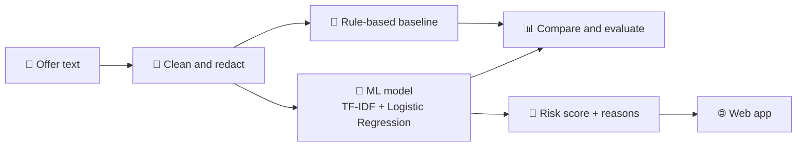

<div align="center">

<br><br>
 


 
**Paste a suspicious offer → get a risk score → see the red flags behind it.**
 
</div>
---
 
## 🚨 The Problem
 
Every placement season, students receive offers that look real but aren't:
 
- *"Congratulations! You are selected. Pay ₹999 for training and onboarding."*
- *"Urgent hiring, work from home, ₹40,000/month. Join our Telegram group."*
- Offer letters from personal Gmail addresses using a real company's name.
Many students, especially first-years, can't easily tell these apart from genuine offers, and some lose money or personal data.
 
Public scam datasets exist, but they are mostly older, non-Indian job ads. Indian internship scams look different: WhatsApp messages, Telegram links, registration fees, and Hinglish text. **OfferLens studies that gap and builds a detector for the scams students here actually receive.**
 
---
 
## ✨ What It Does
 
| Feature | Description |
|---|---|
| 🔍 **Risk score** | Rates how suspicious a posting or message is |
| 🚩 **Red-flag explanations** | Shows *why*, such as payment requests, urgency, or unofficial contact channels |
| ⚖️ **Honest output** | Says "Suspicious, please verify," never "Safe" |
| 📊 **Transparent evaluation** | Compares rule-based, classic ML, and LLM approaches on the same data |
 
---
 
## ⚙️ How It Works
 

 
---
 
## 🧪 Research Questions
 
1. How well does a model trained on a public dataset detect **Indian** internship scams?
2. Does adding locally collected examples improve detection?
3. How does a simple ML model compare with keyword rules and an LLM in accuracy, cost, and consistency?
---
 
## 📈 Results
 
> 🚧 Results will be added after final evaluation on a held-out test set.
 
| Approach | Precision | Recall | F1 |
|---|---|---|---|
| Rule-based baseline | TBD | TBD | TBD |
| ML (public data only) | TBD | TBD | TBD |
| ML (public + local data) | TBD | TBD | TBD |
| LLM comparison | TBD | TBD | TBD |
 
**Recall** on scams is the priority metric: missing a real scam is worse than flagging a genuine offer for verification.
 
---
 
## 🗺️ Roadmap
 
- [ ] **Week 1:** Project setup, red-flag research, first 20 examples
- [ ] **Week 2:** Labeling guidelines and 100 labeled examples
- [ ] **Week 3:** Rule-based baseline
- [ ] **Week 4:** First ML model and distribution-shift test
- [ ] **Week 5:** Error analysis and explanations
- [ ] **Week 6:** FastAPI backend
- [ ] **Week 7:** Web frontend
- [ ] **Week 8:** LLM comparison and deployment
- [ ] **Week 9:** User testing with students
- [ ] **Week 10:** Final evaluation and write-up
---
 
## 🛠️ Tech Stack
 
**Language:** Python · **Data:** pandas · **ML:** scikit-learn · **Backend:** FastAPI · **Frontend:** HTML, CSS, JavaScript · **Version control:** Git and GitHub
 
---
 
## 📁 Project Structure
 
```
internship-scam-detector/
├── data/
│   ├── raw/            # original screenshots (never committed)
│   └── labeled.csv     # redacted, labeled examples
├── notebooks/          # experiments and analysis
├── src/                # source code
├── notes/              # research notes and weekly logs
└── README.md
```
 
---
 
## 🔒 Data and Privacy
 
- All personal details (names, phone numbers, emails) are replaced with `[NAME]`, `[PHONE]`, and `[EMAIL]` before storage.
- Raw screenshots are **never** uploaded to this repository.
- Examples are shared voluntarily by students for this project.
---
 
## 🤝 Contribute Examples
 
Received a suspicious internship or job offer? You can help improve OfferLens:
 
1. **Remove** all names, phone numbers, emails, and links that identify real people.
2. Open an **Issue** with the message text, or contact me directly.
---
 
## ⚠️ Disclaimer
 
OfferLens is a student research project. It can make mistakes and **does not guarantee** that any offer is safe or fraudulent. Always verify offers through official company websites or your college placement cell. Never pay money to get a job or internship.
 
---
 
## 📄 License
 
Released under the [MIT License](LICENSE).
 
---
 
<div align="center">
**Built by [Samarth Tomer](https://github.com/Samarth-CodeX)**
 
⭐ Star this repo if you find it useful!
 
</div>